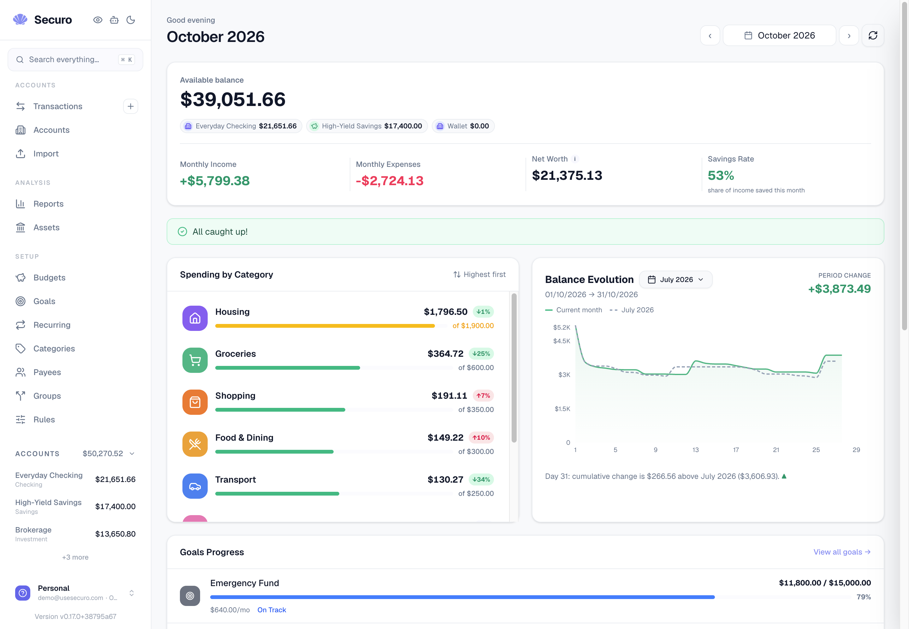

<p align="center">
  
</p>
<h1 align="center">Securo</h1>
<p align="center">
  <a href="https://www.buymeacoffee.com/usesecuro"></a>
  <br />
  <a href="https://github.com/securo-finance/securo/actions/workflows/ci.yml?query=branch%3Amain"></a>
  
  <a href="https://github.com/securo-finance/securo/pkgs/container/securo-frontend"></a>
  <br />
  <a href="https://artifacthub.io/packages/search?repo=securo"></a>
  <a href="https://www.gnu.org/licenses/agpl-3.0"></a>
  <a href="https://discord.gg/rUqTKtQ9S4"></a>
  <br />
  <a href="https://usesecuro.com/">Website</a> · <a href="https://demo.usesecuro.com/">Demo</a> · <a href="https://www.usesecuro.com/roadmap">Roadmap</a> · <a href="https://docs.usesecuro.com/">Docs</a> · <a href="https://discord.gg/rUqTKtQ9S4">Discord</a> · <a href="https://cal.com/tassio/15min">Talk to the maintainer</a>
</p>

<h3 align="center">Finance apps want your data. This one doesn't.</h3>

<p align="center">
We believe personal finance should actually be <em>personal</em>. No corporation should sit between you and your financial data. Securo is an open-source finance manager that runs on your own infrastructure, giving you full visibility into your accounts, spending, and habits, without surrendering a single byte to third parties. Take back control.
</p>

## Quick Start

**Linux & macOS** (uses Docker or Podman; installs Docker if neither is present):

```bash
curl -fsSL https://usesecuro.com/install.sh | bash
```

**Windows:** Install [Docker Desktop](https://www.docker.com/products/docker-desktop/), then:

```bash
git clone https://github.com/securo-finance/securo.git && cd securo
docker compose up --build
```

Open [http://localhost:3000](http://localhost:3000) and create an account. That's it.

<p align="center">
  
</p>

## Features

- Multi-account management with running balances
- Transaction management with search, filters, and CSV export
- File import (OFX, QIF, CAMT, CSV)
- Auto-categorization rules engine
- Recurring transactions, budgets, and loan/financing tracking
- Goals and savings targets with progress tracking
- Asset management with valuation tracking and growth rules
- Reports: Net Worth and Income vs Expenses with category sparklines
- Multi-currency support with automatic FX conversion
- Multi-user support with workspaces, roles, and an admin panel
- Passkeys, two-factor authentication (TOTP), and OIDC single sign-on
- Bank sync via providers (Pluggy, Enable Banking, SimpleFIN, extensible)
- AI Agents (optional): self-hosted LLM chat with tool-use over your data

### Reporting dates and bank balances

Synchronized transactions can have a reporting-date override without changing
the bank's booking date. Clear the override to restore automatic attribution;
later bank syncs preserve the override.

Reporting periods and transaction-list dates follow the override. Account
running balances and posted cash-flow balance movements still follow the bank
date (or the effective movement date in accrual mode). A posted expense
attributed to a future period appears in that period's cash-flow outflow, but
is not deducted from the projected balance a second time. Pending card rows
retain their manually selected bill date for forecast outflow and projected
balance timing, including in cash mode.

The calendar offers separate reporting-date and bank-date views. Moved rows
retain their original bank date in the transaction list.

## Optional capabilities

Everything beyond the core is off by default, needs a single env flag, and costs nothing until you turn it on. Full setup guides live in the [documentation](https://docs.usesecuro.com/):

- **Bank sync**: Pluggy for Brazilian banks, Enable Banking for ~2500 European PSD2 banks, and SimpleFIN for US and international banks. [Setup guides](https://docs.usesecuro.com/features/bank-sync/) Administrators can also set provider credentials in-app under **Admin Settings → Providers**, without a restart ([provider settings](docs/provider-settings.md)).
- **Login & security**: passkeys (Touch ID, Face ID, security keys), TOTP two-factor, and OIDC single sign-on with account linking and provider role sync. [Guide](https://docs.usesecuro.com/features/security/)
- **Exchange rates**: a free [Open Exchange Rates](https://openexchangerates.org/) key, set in `.env` or under **Admin Settings → Providers**, enables automatic currency conversion; without one, cross-currency amounts fall back to 1:1 with a visual warning. [Details](https://docs.usesecuro.com/deployment/docker/)
- **Timezone**: balances, budgets, and due dates turn over at midnight in your application timezone, set once in Admin Settings, with per-workspace overrides. [Details](https://docs.usesecuro.com/features/workspaces/)
- **Plugins**: install categories and rules made by the community into a workspace from the plugin catalog, with a preview before anything changes. Only the catalog is downloaded; no workspace data leaves your server. `PLUGINS_ENABLED=true`.
- **AI Agents**: self-hosted assistants over your data, multi-provider, with tool use and a per-agent knowledge base. [Guide](https://docs.usesecuro.com/features/agents/)

## AI-Assisted Development

Parts of this codebase were built with help of AI. All code is human-reviewed and no data leaves your environment.

Contributing with AI is welcome. We review the author, not the tool: whatever wrote the diff, you own its quality, its fit with where Securo is going, and everything that happens after it merges. See [Using AI](CONTRIBUTING.md#using-ai).

## Support Securo

Securo is free and open source, and it runs entirely on your own infrastructure. If it helps you, a coffee keeps development going:

<p align="center">
  <a href="https://www.buymeacoffee.com/usesecuro"></a>
</p>

## Contributing

See [CONTRIBUTING.md](CONTRIBUTING.md) for setup and guidelines.

Not sure where to start, or want to talk something through first? [Book 15 minutes](https://cal.com/tassio/15min) — no agenda needed. Something broken, an idea, or just what you think of Securo, all welcome.

## License

This project is licensed under the [GNU Affero General Public License v3.0](LICENSE).

This means you can freely use, modify, and distribute this software, but any modifications — including when used as a network service (SaaS) — must also be released under the AGPL-3.0.
